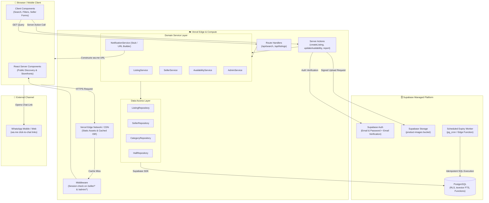
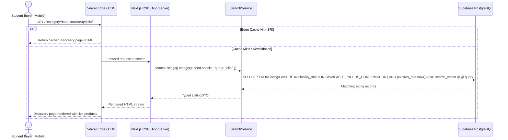
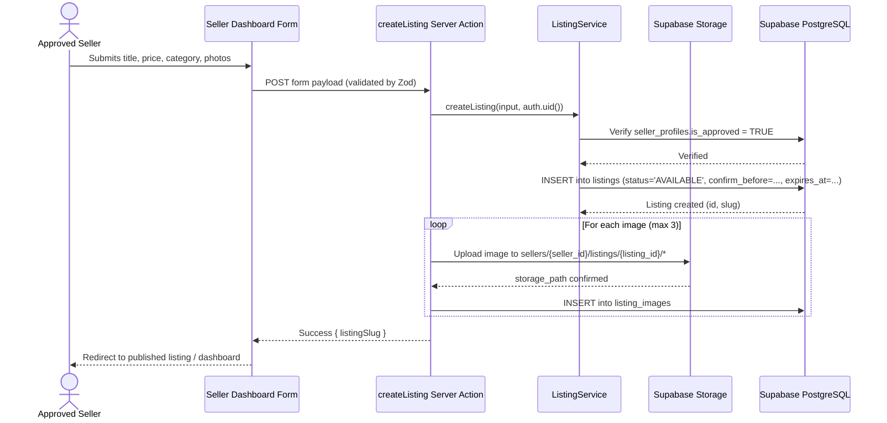
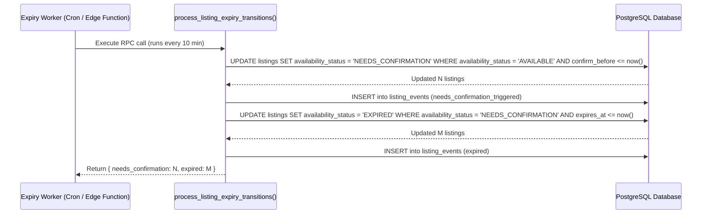
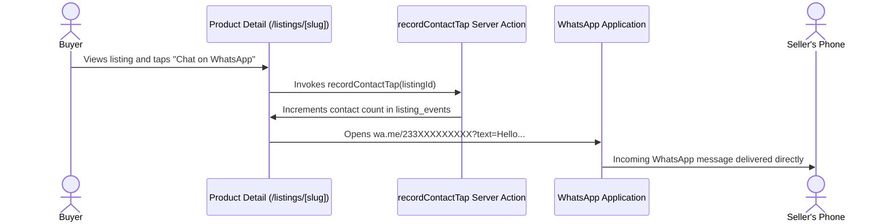

# System Architecture — Campus Store

> **Platform:** WhatsApp-Native Campus Product Discovery Network (University of Ghana, Legon pilot)  
> **Version:** 2.0 — Modular Monolith Specification  
> **Stack:** Next.js (App Router) · TypeScript (strict) · Tailwind CSS · Supabase (PostgreSQL, Auth, Storage, RLS) · Vercel

---

## Table of Contents

1. [Architecture Overview & Monolith Rationale](#1-architecture-overview--monolith-rationale)
2. [High-Level System Architecture Diagram](#2-high-level-system-architecture-diagram)
3. [Module Responsibilities & Boundaries](#3-module-responsibilities--boundaries)
   - 3.1 [Frontend Rendering Layer](#31-frontend-rendering-layer)
   - 3.2 [Application Services (Domain Modules)](#32-application-services-domain-modules)
   - 3.3 [Data Access Layer (Repository Pattern)](#33-data-access-layer-repository-pattern)
   - 3.4 [Authentication & Session Architecture](#34-authentication--session-architecture)
   - 3.5 [Media Storage & Image Pipeline](#35-media-storage--image-pipeline)
   - 3.6 [WhatsApp Click-to-Chat Integration](#36-whatsapp-click-to-chat-integration)
4. [End-to-End Sequence & Request Flows](#4-end-to-end-sequence--request-flows)
   - 4.1 [Marketplace Discovery & Query Flow](#41-marketplace-discovery--query-flow)
   - 4.2 [Seller Listing Creation Flow](#42-seller-listing-creation-flow)
   - 4.3 [Two-Phase Expiry Worker Execution Flow](#43-two-phase-expiry-worker-execution-flow)
   - 4.4 [Buyer Contact Initiation Flow](#44-buyer-contact-initiation-flow)
5. [Caching & Performance Strategy](#5-caching--performance-strategy)
6. [Future Automation Extension Boundary](#6-future-automation-extension-boundary)
7. [Campus Multi-Hall Scalability Model](#7-campus-multi-hall-scalability-model)
8. [Architecture Decision Records (ADRs)](#8-architecture-decision-records-adrs)

---

## 1. Architecture Overview & Monolith Rationale

Campus Store is engineered as a **modular monolith** inside a single Next.js project deployed on Vercel, paired with a managed Supabase backend.

```
┌─────────────────────────────────────────────────────────────┐
│                 Next.js App (Vercel)                        │
│  ┌────────────────────────┐     ┌────────────────────────┐  │
│  │ Public Discovery (RSC) │     │ Seller/Admin UI (CC)   │  │
│  └───────────┬────────────┘     └───────────┬────────────┘  │
│              │                              │               │
│  ┌───────────▼──────────────────────────────▼────────────┐  │
│  │ Next.js Server Actions / Route Handlers (Layer 3)     │  │
│  └───────────┬───────────────────────────────────────────┘  │
│              │                                              │
│  ┌───────────▼───────────────────────────────────────────┐  │
│  │ Domain Service Layer (Listing, Seller, Expiry, Admin) │  │
│  └───────────┬───────────────────────────────────────────┘  │
│              │                                              │
│  ┌───────────▼───────────────────────────────────────────┐  │
│  │ Typed Repositories (Data Access Layer)                │  │
│  └───────────┬───────────────────────────────────────────┘  │
└──────────────┼──────────────────────────────────────────────┘
               │  Supabase Client SDK / Pooled SQL
┌──────────────▼──────────────────────────────────────────────┐
│                 Supabase Managed Services                   │
│  • PostgreSQL (RLS, Full-Text Search, Stored Functions)     │
│  • Supabase Auth (Email + Password + Verification)          │
│  • Supabase Storage (product-images bucket)                 │
└─────────────────────────────────────────────────────────────┘
```

### Why a Modular Monolith?
- **Operational Simplicity:** Avoids managing multi-service deployments, distributed networking, message brokers, or cross-service sagas for an initial 10-seller campus pilot.
- **Transactional Consistency:** State transitions, listing creations, and image associations run with full relational integrity within PostgreSQL.
- **Clear Decoupling:** Business domains are isolated into dedicated modules (`ListingService`, `SellerService`, `AvailabilityService`, `AdminService`). No domain logic is placed inside React components.

---

## 2. High-Level System Architecture Diagram



---

## 3. Module Responsibilities & Boundaries

### 3.1 Frontend Rendering Layer

1. **React Server Components (RSC):**
   - Renders public discovery pages (`/`, `/categories/[slug]`, `/listings/[slug]`, `/store/[storefront_slug]`).
   - Fetches data directly via repository queries on the server.
   - Generates minimal client JavaScript for fast mobile loading on student 4G data.
2. **Client Components (`"use client"`):**
   - Confined strictly to user interaction: search input debouncing, filter chip selection, image selection forms, and modal dialogs.
   - Delegates all mutations to Server Actions.
3. **Next.js Middleware (`middleware.ts`):**
   - Intercepts requests to `/seller/*` and `/admin/*`.
   - Validates session cookies via `@supabase/ssr`.
   - Enforces admin role for `/admin/*` via `profiles.is_admin = TRUE`.

---

### 3.2 Application Services (Domain Modules)

Each module lives under `src/services/` and encapsulates specific business rules:

#### `ListingService`
- Coordinates listing creation and updates.
- Validates seller approval status before publishing.
- Enforces single lifecycle status (`DRAFT`, `AVAILABLE`, `NEEDS_CONFIRMATION`, `SOLD_OUT`, `EXPIRED`, `PAUSED`, `REMOVED`).
- Ensures soft-deletion via `deleted_at`.

#### `AvailabilityService`
- Calculates `confirm_before` and `expires_at` from category defaults.
- Handles availability state transitions (e.g., `AVAILABLE` -> `PAUSED`, `NEEDS_CONFIRMATION` -> `AVAILABLE`).
- Executes the two-phase expiry worker logic (`process_listing_expiry_transitions()`).

#### `SellerService`
- Manages seller profile creation and digital storefront configuration.
- Enforces uniqueness and immutability of `storefront_slug`.
- Formats WhatsApp numbers to E.164.

#### `AdminService`
- Gated by admin privileges.
- Approves or rejects seller onboarding applications.
- Manages content moderation, listing takedowns, and report resolution.

#### `NotificationService` (V1 Stub)
- Construct formatted, pre-filled WhatsApp click-to-chat URLs (`https://wa.me/<E.164>?text=...`).
- Has zero external API dependencies in V1.

---

### 3.3 Data Access Layer (Repository Pattern)

- Repositories under `src/repositories/` isolate all Supabase SQL interactions.
- Server-side clients use `@supabase/ssr` cookies for user context (RLS-enforced) or `SUPABASE_SERVICE_ROLE_KEY` for internal operations.
- Direct database calls from React components are prohibited.

---

### 3.4 Authentication & Session Architecture

- **Auth Engine:** Supabase Auth using **Email and Password with Email Verification**.
- **Session Tokens:** JWT stored in secure `httpOnly`, `SameSite=Lax`, `Secure` cookies.
- **Buyers:** Always anonymous. No tokens or sessions issued for browsing.
- **Privilege Separation:**
  - `profiles.is_admin = TRUE` defines admin rights.
  - `seller_profiles.user_id = auth.users(id)` links authenticated sellers to their digital storefront.

---

### 3.5 Media Storage & Image Pipeline

- **Storage Bucket:** `product-images` (public read access via CDN).
- **Constraints:** Up to 3 images per listing, max 2 MB per file, formats: JPEG, PNG, WebP.
- **Client Compression:** Images are compressed in the browser (target < 500 KB) before upload.
- **Upload Flow:** Client requests signed path from Server Action -> direct upload to Supabase Storage -> path attached to `listing_images`.

---

### 3.6 WhatsApp Click-to-Chat Integration

- Interaction is initiated via `https://wa.me/<E.164_number>?text=<encoded_message>`.
- The URL includes the seller's verified phone number and pre-filled product context:
  `"Hello, I found your [Product Title] on Campus Store. Is it still available?"`
- No WhatsApp Business API or automated webhook bot is used in V1.

---

## 4. End-to-End Sequence & Request Flows

### 4.1 Marketplace Discovery & Query Flow



---

### 4.2 Seller Listing Creation Flow



---

### 4.3 Two-Phase Expiry Worker Execution Flow



---

### 4.4 Buyer Contact Initiation Flow



---

## 5. Caching & Performance Strategy

| Page Route | Strategy | Revalidation Window | Rationale |
|---|---|---|---|
| `/` (Homepage) | ISR | 60 seconds | High traffic discovery; short revalidation balances freshness with speed |
| `/categories/[slug]` | ISR | 60 seconds | Category browsing |
| `/listings/[slug]` | ISR + On-Demand | 30 seconds | Shows product availability; cache is purged immediately upon seller edit |
| `/store/[storefront_slug]` | ISR | 60 seconds | Public seller storefront |
| `/seller/*` | Dynamic (`no-store`) | 0 seconds | Must always reflect real-time listing statuses |
| `/admin/*` | Dynamic (`no-store`) | 0 seconds | Real-time moderation views |

---

## 6. Future Automation Extension Boundary

In V1, `NotificationService` acts solely as a URL generator:

```typescript
export interface NotificationProvider {
  buildWhatsAppUrl(params: {
    phoneNumber: string;
    productTitle: string;
    platformName: string;
  }): string;
}
```

If WhatsApp Business API or automated messaging is introduced in V2, the service interface expands to support server-initiated messages without altering `ListingService` or `SellerService`.

---

## 7. Campus Multi-Hall Scalability Model

The database stores `halls` and `universities` as relational entities from day one:
- Listings are scoped to a hall through `seller_profiles.hall_id`.
- The pilot configures the active hall via `NEXT_PUBLIC_DEFAULT_HALL_SLUG=commonwealth`.
- Expanding to additional halls at Legon (or KNUST) requires adding rows to `halls` without schema alterations or code refactoring.

---

## 8. Architecture Decision Records (ADRs)

### ADR-001: Modular Monolith Architecture
- **Decision:** Build a single deployable Next.js app with distinct domain modules rather than microservices.
- **Rationale:** Appropriate for pilot scale, zero inter-service network overhead, ACID transactions.

### ADR-002: Supabase Managed Platform
- **Decision:** Use Supabase for PostgreSQL, Auth, and Storage.
- **Rationale:** Native RLS, built-in connection pooler (PgBouncer), integrated authentication with zero server management.

### ADR-003: Email + Password Authentication for MVP
- **Decision:** Use email and password with email verification for sellers; keep buyers unauthenticated.
- **Rationale:** Zero per-message SMS costs, dependable on campus, avoids OTP failure modes in Ghana.

### ADR-004: Two-Phase Expiry Lifecycle
- **Decision:** Introduce `confirm_before` and `expires_at` with category defaults.
- **Rationale:** Automatically flags time-sensitive listings as `NEEDS_CONFIRMATION` before eventual expiry, preserving buyer trust.

### ADR-005: WhatsApp Click-to-Chat over Business API
- **Decision:** Use `wa.me` links without API keys or webhooks in V1.
- **Rationale:** Free, instant, leverages student habits without business verification delays.

---

*Architecture specification verified and complete.*
