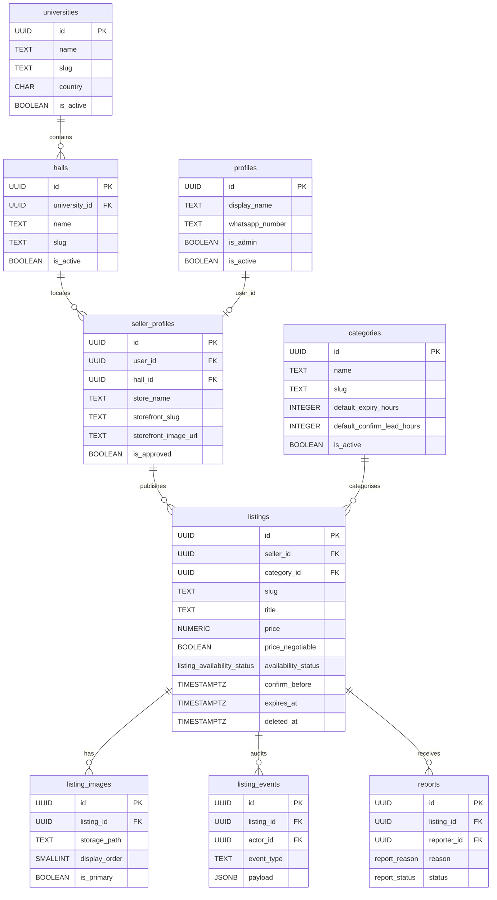

# Database Schema — Campus Store

> **Platform:** Campus product discovery platform (University of Ghana, Legon pilot)  
> **Database:** PostgreSQL 15+ via Supabase  
> **Stack:** Next.js (App Router) · TypeScript (strict) · Modular Monolith  
> **Version:** v2.0 — Standardized, canonical lifecycle & strict RLS specification

---

## Table of Contents

1. [Design Principles](#1-design-principles)
2. [Schema Overview](#2-schema-overview)
3. [Canonical Enum & Status Types](#3-canonical-enum--status-types)
4. [Table Definitions](#4-table-definitions)
   - 4.1 [universities](#41-universities)
   - 4.2 [halls](#42-halls)
   - 4.3 [profiles](#43-profiles)
   - 4.4 [seller_profiles](#44-seller_profiles)
   - 4.5 [categories](#45-categories)
   - 4.6 [listings](#46-listings)
   - 4.7 [listing_images](#47-listing_images)
   - 4.8 [listing_events](#48-listing_events)
   - 4.9 [reports](#49-reports)
5. [Canonical Listing Lifecycle & Expiry Architecture](#5-canonical-listing-lifecycle--expiry-architecture)
6. [Indexes](#6-indexes)
7. [Triggers and Functions](#7-triggers-and-functions)
8. [Entity Relationship (ER) Diagram](#8-entity-relationship-er-diagram)
9. [Data Visibility & Access Matrix](#9-data-visibility--access-matrix)
10. [Seed Data Specification](#10-seed-data-specification)
11. [Migration Strategy](#11-migration-strategy)

---

## 1. Design Principles

These architectural standards apply across every table in the database:

| Principle | Standard |
|---|---|
| **Primary Keys** | `UUID` generated via `gen_random_uuid()` for all public/business entities. Never expose serial auto-increment IDs. |
| **Timestamps** | All tables include `created_at TIMESTAMPTZ NOT NULL DEFAULT now()` and `updated_at TIMESTAMPTZ NOT NULL DEFAULT now()`. All stored in UTC. |
| **Soft Deletes** | Auditable entities (`listings`) use `deleted_at TIMESTAMPTZ NULL`. A `NULL` value means the record is active; non-null indicates soft deletion. |
| **Monetary Values** | All prices use `NUMERIC(12,2)`. `FLOAT` or `REAL` types are strictly prohibited to prevent floating-point rounding errors. Currency defaults to `GHS`. |
| **Phone Numbers** | WhatsApp numbers are formatted and stored in strict [E.164](https://en.wikipedia.org/wiki/E.164) format (e.g., `+233501234567`). |
| **Single Source of Truth** | Listing visibility is derived strictly from `availability_status` (and `deleted_at IS NULL`). Overlapping flags like `is_active` on listings are completely removed. |
| **Ownership Integrity** | `seller_profiles.user_id` references `auth.users(id)` with a `UNIQUE` constraint, establishing an unambiguous 1:1 user-to-seller-profile relation. |
| **Two-Phase Expiry** | Listings support two-phase lifecycle tracking using both `confirm_before TIMESTAMPTZ` and `expires_at TIMESTAMPTZ`, driven by category configuration. |
| **Row Level Security** | RLS is explicitly enabled on 100% of tables. Public access is strictly read-only for eligible live listings and storefronts. |

---

## 2. Schema Overview

The database is partitioned into five functional domains:

```
┌─────────────────────────────────────────────────────────────┐
│  1. Campus Topology                                         │
│  universities (UG Legon) ──< halls (Commonwealth, Volta...) │
├─────────────────────────────────────────────────────────────┤
│  2. Identity & Storefronts                                  │
│  auth.users ──1:1── profiles                                │
│  auth.users ──1:1── seller_profiles (storefront_slug)       │
├─────────────────────────────────────────────────────────────┤
│  3. Product Catalogue                                       │
│  categories ──< listings ──< listing_images                 │
│  (Two-phase expiry: confirm_before & expires_at)             │
├─────────────────────────────────────────────────────────────┤
│  4. Moderation & Trust                                      │
│  listings ──< reports (anonymous or authenticated)          │
├─────────────────────────────────────────────────────────────┤
│  5. Audit & Activity Tracking                               │
│  listings ──< listing_events (immutable audit log)          │
└─────────────────────────────────────────────────────────────┘
```

---

## 3. Canonical Enum & Status Types

### Listing Availability Status
Every listing exists in exactly one canonical lifecycle state. All database enums and application codes use uppercase values:

```sql
CREATE TYPE listing_availability_status AS ENUM (
  'DRAFT',               -- Under composition; never visible publicly
  'AVAILABLE',           -- Live and purchasable; visible in discovery & storefront
  'NEEDS_CONFIRMATION',  -- confirm_before has passed; visible with warning badge
  'SOLD_OUT',            -- Marked sold out by seller; hidden from general discovery
  'EXPIRED',             -- expires_at passed without confirmation; hidden
  'PAUSED',              -- Temporarily paused by seller; hidden
  'REMOVED'              -- Soft-deleted or taken down by admin; hidden permanently
);
```

### Report Status & Reason Enums

```sql
CREATE TYPE report_reason AS ENUM (
  'spam',
  'misleading',
  'inappropriate',
  'already_sold',
  'wrong_price',
  'prohibited_item',
  'other'
);

CREATE TYPE report_status AS ENUM (
  'pending',
  'reviewed',
  'dismissed',
  'actioned'
);
```

---

## 4. Table Definitions

### 4.1 `universities`

Scopes campus deployments. V1 seeds the University of Ghana (`ug`).

```sql
CREATE TABLE public.universities (
  id          UUID        NOT NULL DEFAULT gen_random_uuid() PRIMARY KEY,
  name        TEXT        NOT NULL,
  slug        TEXT        NOT NULL UNIQUE,
  city        TEXT        NOT NULL,
  country     CHAR(2)     NOT NULL DEFAULT 'GH',
  is_active   BOOLEAN     NOT NULL DEFAULT TRUE,
  created_at  TIMESTAMPTZ NOT NULL DEFAULT now(),
  updated_at  TIMESTAMPTZ NOT NULL DEFAULT now()
);

ALTER TABLE public.universities ENABLE ROW LEVEL SECURITY;

CREATE POLICY "universities_public_read"
  ON public.universities FOR SELECT
  USING (is_active = TRUE);

CREATE POLICY "universities_admin_all"
  ON public.universities FOR ALL
  USING (
    EXISTS (
      SELECT 1 FROM public.profiles
      WHERE profiles.id = auth.uid() AND profiles.is_admin = TRUE
    )
  );
```

---

### 4.2 `halls`

Physical residence halls on campus. Every seller profile belongs to one hall.

```sql
CREATE TABLE public.halls (
  id             UUID        NOT NULL DEFAULT gen_random_uuid() PRIMARY KEY,
  university_id  UUID        NOT NULL REFERENCES public.universities(id) ON DELETE RESTRICT,
  name           TEXT        NOT NULL,
  slug           TEXT        NOT NULL,
  is_active      BOOLEAN     NOT NULL DEFAULT TRUE,
  created_at     TIMESTAMPTZ NOT NULL DEFAULT now(),
  updated_at     TIMESTAMPTZ NOT NULL DEFAULT now(),

  CONSTRAINT halls_university_slug_unique UNIQUE (university_id, slug)
);

CREATE INDEX idx_halls_university_id ON public.halls(university_id);

ALTER TABLE public.halls ENABLE ROW LEVEL SECURITY;

CREATE POLICY "halls_public_read"
  ON public.halls FOR SELECT
  USING (is_active = TRUE);

CREATE POLICY "halls_admin_all"
  ON public.halls FOR ALL
  USING (
    EXISTS (
      SELECT 1 FROM public.profiles
      WHERE profiles.id = auth.uid() AND profiles.is_admin = TRUE
    )
  );
```

---

### 4.3 `profiles`

Extension of `auth.users`. Contains user display identity and platform roles. Created via auth trigger upon user signup.

```sql
CREATE TABLE public.profiles (
  id               UUID        NOT NULL PRIMARY KEY REFERENCES auth.users(id) ON DELETE CASCADE,
  display_name     TEXT        NOT NULL CHECK (char_length(display_name) BETWEEN 2 AND 60),
  whatsapp_number  TEXT        NOT NULL CHECK (whatsapp_number ~ '^\+[1-9]\d{7,14}$'),
  avatar_url       TEXT        NULL,
  bio              TEXT        NULL CHECK (char_length(bio) <= 300),
  is_admin         BOOLEAN     NOT NULL DEFAULT FALSE,
  is_active        BOOLEAN     NOT NULL DEFAULT TRUE,
  created_at       TIMESTAMPTZ NOT NULL DEFAULT now(),
  updated_at       TIMESTAMPTZ NOT NULL DEFAULT now()
);

CREATE INDEX idx_profiles_whatsapp_number ON public.profiles(whatsapp_number);

ALTER TABLE public.profiles ENABLE ROW LEVEL SECURITY;

-- Public can read basic profile details for approved sellers
CREATE POLICY "profiles_public_read"
  ON public.profiles FOR SELECT
  USING (
    is_active = TRUE
    AND EXISTS (
      SELECT 1 FROM public.seller_profiles sp
      WHERE sp.user_id = profiles.id AND sp.is_approved = TRUE
    )
  );

-- Users can inspect their own profile in full
CREATE POLICY "profiles_owner_read"
  ON public.profiles FOR SELECT
  USING (auth.uid() = id);

-- User inserts their own profile at registration
CREATE POLICY "profiles_owner_insert"
  ON public.profiles FOR INSERT
  WITH CHECK (auth.uid() = id AND is_admin = FALSE);

-- User updates their own non-privileged profile columns
CREATE POLICY "profiles_owner_update"
  ON public.profiles FOR UPDATE
  USING (auth.uid() = id)
  WITH CHECK (auth.uid() = id);

-- Admins retain full management
CREATE POLICY "profiles_admin_all"
  ON public.profiles FOR ALL
  USING (
    EXISTS (
      SELECT 1 FROM public.profiles p
      WHERE p.id = auth.uid() AND p.is_admin = TRUE
    )
  );
```

---

### 4.4 `seller_profiles`

Defines the seller entity and public storefront. A user has at most one seller profile.

```sql
CREATE TABLE public.seller_profiles (
  id                   UUID        NOT NULL DEFAULT gen_random_uuid() PRIMARY KEY,
  user_id              UUID        NOT NULL UNIQUE REFERENCES auth.users(id) ON DELETE CASCADE,
  hall_id              UUID        NOT NULL REFERENCES public.halls(id) ON DELETE RESTRICT,
  store_name           TEXT        NOT NULL CHECK (char_length(store_name) BETWEEN 2 AND 60),
  storefront_slug      TEXT        NOT NULL UNIQUE CHECK (storefront_slug ~ '^[a-z0-9]+(-[a-z0-9]+)*$' AND char_length(storefront_slug) BETWEEN 2 AND 60),
  storefront_image_url TEXT        NULL,
  store_description    TEXT        NULL CHECK (char_length(store_description) <= 500),
  is_approved          BOOLEAN     NOT NULL DEFAULT FALSE,
  approved_at          TIMESTAMPTZ NULL,
  approved_by          UUID        NULL REFERENCES public.profiles(id) ON DELETE SET NULL,
  created_at           TIMESTAMPTZ NOT NULL DEFAULT now(),
  updated_at           TIMESTAMPTZ NOT NULL DEFAULT now(),

  CONSTRAINT seller_profiles_hall_store_name_unique UNIQUE (hall_id, store_name)
);

CREATE INDEX idx_seller_profiles_user_id ON public.seller_profiles(user_id);
CREATE INDEX idx_seller_profiles_hall_id ON public.seller_profiles(hall_id);
CREATE INDEX idx_seller_profiles_slug    ON public.seller_profiles(storefront_slug);

ALTER TABLE public.seller_profiles ENABLE ROW LEVEL SECURITY;

-- Public read for approved storefronts
CREATE POLICY "seller_profiles_public_read"
  ON public.seller_profiles FOR SELECT
  USING (is_approved = TRUE);

-- Seller reads their own profile regardless of approval status
CREATE POLICY "seller_profiles_owner_read"
  ON public.seller_profiles FOR SELECT
  USING (auth.uid() = user_id);

-- Authenticated user creates their own profile (starts unapproved)
CREATE POLICY "seller_profiles_owner_insert"
  ON public.seller_profiles FOR INSERT
  WITH CHECK (auth.uid() = user_id AND is_approved = FALSE);

-- Seller updates own store info (cannot self-approve)
CREATE POLICY "seller_profiles_owner_update"
  ON public.seller_profiles FOR UPDATE
  USING (auth.uid() = user_id)
  WITH CHECK (
    auth.uid() = user_id
    AND is_approved = (SELECT sp.is_approved FROM public.seller_profiles sp WHERE sp.id = seller_profiles.id)
  );

-- Admins approve, update or moderate all seller profiles
CREATE POLICY "seller_profiles_admin_all"
  ON public.seller_profiles FOR ALL
  USING (
    EXISTS (
      SELECT 1 FROM public.profiles p
      WHERE p.id = auth.uid() AND p.is_admin = TRUE
    )
  );
```

---

### 4.5 `categories`

Product categories with configurable expiry duration and confirmation lead times.

```sql
CREATE TABLE public.categories (
  id                          UUID        NOT NULL DEFAULT gen_random_uuid() PRIMARY KEY,
  name                        TEXT        NOT NULL,
  slug                        TEXT        NOT NULL UNIQUE,
  icon                        TEXT        NULL,
  sort_order                  SMALLINT    NOT NULL DEFAULT 0,
  default_expiry_hours        INTEGER     NULL CHECK (default_expiry_hours > 0),
  default_confirm_lead_hours  INTEGER     NULL CHECK (default_confirm_lead_hours >= 0),
  is_active                   BOOLEAN     NOT NULL DEFAULT TRUE,
  created_at                  TIMESTAMPTZ NOT NULL DEFAULT now(),
  updated_at                  TIMESTAMPTZ NOT NULL DEFAULT now(),

  CONSTRAINT categories_lead_time_less_than_expiry
    CHECK (default_confirm_lead_hours IS NULL OR default_expiry_hours IS NULL OR default_confirm_lead_hours < default_expiry_hours)
);

CREATE INDEX idx_categories_sort_order ON public.categories(sort_order);

ALTER TABLE public.categories ENABLE ROW LEVEL SECURITY;

CREATE POLICY "categories_public_read"
  ON public.categories FOR SELECT
  USING (is_active = TRUE);

CREATE POLICY "categories_admin_all"
  ON public.categories FOR ALL
  USING (
    EXISTS (
      SELECT 1 FROM public.profiles p
      WHERE p.id = auth.uid() AND p.is_admin = TRUE
    )
  );
```

---

### 4.6 `listings`

The central product listing table. One seller manages multiple listings across categories.

```sql
CREATE TABLE public.listings (
  id                   UUID                        NOT NULL DEFAULT gen_random_uuid() PRIMARY KEY,
  seller_id            UUID                        NOT NULL REFERENCES public.seller_profiles(id) ON DELETE RESTRICT,
  category_id          UUID                        NOT NULL REFERENCES public.categories(id) ON DELETE RESTRICT,
  slug                 TEXT                        NOT NULL UNIQUE CHECK (slug ~ '^[a-z0-9]+(-[a-z0-9]+)*$' AND char_length(slug) BETWEEN 2 AND 140),
  title                TEXT                        NOT NULL CHECK (char_length(title) BETWEEN 2 AND 120),
  description          TEXT                        NULL CHECK (char_length(description) <= 500),
  price                NUMERIC(12,2)               NULL CHECK (price IS NULL OR price >= 0),
  price_negotiable     BOOLEAN                     NOT NULL DEFAULT FALSE,
  currency             CHAR(3)                     NOT NULL DEFAULT 'GHS',
  availability_status  listing_availability_status NOT NULL DEFAULT 'DRAFT',
  confirm_before       TIMESTAMPTZ                 NULL,
  expires_at           TIMESTAMPTZ                 NULL,
  expired_notified_at  TIMESTAMPTZ                 NULL,
  deleted_at           TIMESTAMPTZ                 NULL,
  search_vector        TSVECTOR                    NULL,
  created_at           TIMESTAMPTZ                 NOT NULL DEFAULT now(),
  updated_at           TIMESTAMPTZ                 NOT NULL DEFAULT now(),

  CONSTRAINT listings_price_check
    CHECK (price IS NOT NULL OR price_negotiable = TRUE),
  CONSTRAINT listings_timestamps_order
    CHECK (confirm_before IS NULL OR expires_at IS NULL OR confirm_before <= expires_at)
);

CREATE INDEX idx_listings_seller_id            ON public.listings(seller_id);
CREATE INDEX idx_listings_category_id          ON public.listings(category_id);
CREATE INDEX idx_listings_availability_status  ON public.listings(availability_status);
CREATE INDEX idx_listings_slug                 ON public.listings(slug);
CREATE INDEX idx_listings_expires_at           ON public.listings(expires_at) WHERE expires_at IS NOT NULL;
CREATE INDEX idx_listings_confirm_before       ON public.listings(confirm_before) WHERE confirm_before IS NOT NULL;
CREATE INDEX idx_listings_search_vector        ON public.listings USING GIN(search_vector);

-- Composite index covering the primary marketplace browse query
CREATE INDEX idx_listings_marketplace_discovery
  ON public.listings(category_id, availability_status, created_at DESC)
  WHERE deleted_at IS NULL AND availability_status IN ('AVAILABLE', 'NEEDS_CONFIRMATION');

ALTER TABLE public.listings ENABLE ROW LEVEL SECURITY;

-- Public read: Only AVAILABLE or NEEDS_CONFIRMATION from approved sellers, not soft-deleted, not passed expiry
CREATE POLICY "listings_public_read"
  ON public.listings FOR SELECT
  USING (
    deleted_at IS NULL
    AND availability_status IN ('AVAILABLE', 'NEEDS_CONFIRMATION')
    AND (expires_at IS NULL OR expires_at > now())
    AND EXISTS (
      SELECT 1 FROM public.seller_profiles sp
      WHERE sp.id = listings.seller_id AND sp.is_approved = TRUE
    )
  );

-- Seller reads their own listings across all states
CREATE POLICY "listings_seller_read_own"
  ON public.listings FOR SELECT
  USING (
    deleted_at IS NULL
    AND EXISTS (
      SELECT 1 FROM public.seller_profiles sp
      WHERE sp.id = listings.seller_id AND sp.user_id = auth.uid()
    )
  );

-- Approved seller inserts listing owned by their seller profile
CREATE POLICY "listings_seller_insert_own"
  ON public.listings FOR INSERT
  WITH CHECK (
    EXISTS (
      SELECT 1 FROM public.seller_profiles sp
      WHERE sp.id = listings.seller_id
        AND sp.user_id = auth.uid()
        AND sp.is_approved = TRUE
    )
  );

-- Seller updates only their own listings
CREATE POLICY "listings_seller_update_own"
  ON public.listings FOR UPDATE
  USING (
    deleted_at IS NULL
    AND EXISTS (
      SELECT 1 FROM public.seller_profiles sp
      WHERE sp.id = listings.seller_id AND sp.user_id = auth.uid()
    )
  )
  WITH CHECK (
    deleted_at IS NULL
    AND EXISTS (
      SELECT 1 FROM public.seller_profiles sp
      WHERE sp.id = listings.seller_id AND sp.user_id = auth.uid()
    )
  );

-- Admins retain full read and update rights
CREATE POLICY "listings_admin_all"
  ON public.listings FOR ALL
  USING (
    EXISTS (
      SELECT 1 FROM public.profiles p
      WHERE p.id = auth.uid() AND p.is_admin = TRUE
    )
  );
```

---

### 4.7 `listing_images`

Images belonging to listings. Maximum 3 photos per listing.

```sql
CREATE TABLE public.listing_images (
  id             UUID        NOT NULL DEFAULT gen_random_uuid() PRIMARY KEY,
  listing_id     UUID        NOT NULL REFERENCES public.listings(id) ON DELETE CASCADE,
  storage_path   TEXT        NOT NULL,
  display_order  SMALLINT    NOT NULL DEFAULT 0 CHECK (display_order BETWEEN 0 AND 2),
  is_primary     BOOLEAN     NOT NULL DEFAULT FALSE,
  created_at     TIMESTAMPTZ NOT NULL DEFAULT now()
);

CREATE INDEX idx_listing_images_listing_id ON public.listing_images(listing_id);
CREATE UNIQUE INDEX idx_listing_images_primary
  ON public.listing_images(listing_id)
  WHERE is_primary = TRUE;

ALTER TABLE public.listing_images ENABLE ROW LEVEL SECURITY;

-- Public can read images for publicly visible listings
CREATE POLICY "listing_images_public_read"
  ON public.listing_images FOR SELECT
  USING (
    EXISTS (
      SELECT 1 FROM public.listings l
      JOIN public.seller_profiles sp ON sp.id = l.seller_id
      WHERE l.id = listing_images.listing_id
        AND l.deleted_at IS NULL
        AND l.availability_status IN ('AVAILABLE', 'NEEDS_CONFIRMATION')
        AND (l.expires_at IS NULL OR l.expires_at > now())
        AND sp.is_approved = TRUE
    )
  );

-- Seller manages images for their own listings
CREATE POLICY "listing_images_seller_manage"
  ON public.listing_images FOR ALL
  USING (
    EXISTS (
      SELECT 1 FROM public.listings l
      JOIN public.seller_profiles sp ON sp.id = l.seller_id
      WHERE l.id = listing_images.listing_id
        AND sp.user_id = auth.uid()
    )
  );

-- Admin management
CREATE POLICY "listing_images_admin_all"
  ON public.listing_images FOR ALL
  USING (
    EXISTS (
      SELECT 1 FROM public.profiles p
      WHERE p.id = auth.uid() AND p.is_admin = TRUE
    )
  );
```

---

### 4.8 `listing_events`

Immutable log of listing transitions, user actions, and buyer contact taps.

```sql
CREATE TABLE public.listing_events (
  id          UUID        NOT NULL DEFAULT gen_random_uuid() PRIMARY KEY,
  listing_id  UUID        NOT NULL REFERENCES public.listings(id) ON DELETE CASCADE,
  actor_id    UUID        NULL REFERENCES public.profiles(id) ON DELETE SET NULL,
  event_type  TEXT        NOT NULL CHECK (event_type IN (
                'created',
                'published',
                'updated',
                'needs_confirmation_triggered',
                'availability_confirmed',
                'sold_out',
                'paused',
                'resumed',
                'expired',
                'reactivated',
                'removed',
                'contact_tapped',
                'reported'
              )),
  payload     JSONB       NOT NULL DEFAULT '{}',
  created_at  TIMESTAMPTZ NOT NULL DEFAULT now()
);

CREATE INDEX idx_listing_events_listing_id  ON public.listing_events(listing_id);
CREATE INDEX idx_listing_events_event_type  ON public.listing_events(event_type);
CREATE INDEX idx_listing_events_created_at  ON public.listing_events(created_at DESC);

ALTER TABLE public.listing_events ENABLE ROW LEVEL SECURITY;

-- Sellers read audit trail of their own listings
CREATE POLICY "listing_events_seller_read"
  ON public.listing_events FOR SELECT
  USING (
    EXISTS (
      SELECT 1 FROM public.listings l
      JOIN public.seller_profiles sp ON sp.id = l.seller_id
      WHERE l.id = listing_events.listing_id
        AND sp.user_id = auth.uid()
    )
  );

-- Inserts are performed via Server Actions (using service_role) or admins
CREATE POLICY "listing_events_admin_all"
  ON public.listing_events FOR ALL
  USING (
    EXISTS (
      SELECT 1 FROM public.profiles p
      WHERE p.id = auth.uid() AND p.is_admin = TRUE
    )
  );
```

---

### 4.9 `reports`

Buyer moderation reports submitted against listings. Anonymous submissions are supported.

```sql
CREATE TABLE public.reports (
  id           UUID          NOT NULL DEFAULT gen_random_uuid() PRIMARY KEY,
  listing_id   UUID          NOT NULL REFERENCES public.listings(id) ON DELETE CASCADE,
  reporter_id  UUID          NULL REFERENCES public.profiles(id) ON DELETE SET NULL,
  reason       report_reason NOT NULL,
  details      TEXT          NULL CHECK (char_length(details) <= 500),
  status       report_status NOT NULL DEFAULT 'pending',
  reviewed_by  UUID          NULL REFERENCES public.profiles(id) ON DELETE SET NULL,
  reviewed_at  TIMESTAMPTZ   NULL,
  created_at   TIMESTAMPTZ   NOT NULL DEFAULT now()
);

CREATE INDEX idx_reports_listing_id ON public.reports(listing_id);
CREATE INDEX idx_reports_status     ON public.reports(status) WHERE status = 'pending';

ALTER TABLE public.reports ENABLE ROW LEVEL SECURITY;

-- Anyone (anonymous or authenticated) can submit a report
CREATE POLICY "reports_submit"
  ON public.reports FOR INSERT
  WITH CHECK (TRUE);

-- Only admins can read or update reports
CREATE POLICY "reports_admin_all"
  ON public.reports FOR ALL
  USING (
    EXISTS (
      SELECT 1 FROM public.profiles p
      WHERE p.id = auth.uid() AND p.is_admin = TRUE
    )
  );
```

---

## 5. Canonical Listing Lifecycle & Expiry Architecture

### 5.1 Canonical Lifecycle States

| State | Public Discovery | Seller Storefront | Expiry Clock Active? | Meaning |
|---|---|---|---|---|
| `DRAFT` | ❌ Hidden | ❌ Hidden | No | Initial creation, unpublished draft |
| `AVAILABLE` | ✅ Visible | ✅ Visible | Yes | Fully available for discovery and inquiries |
| `NEEDS_CONFIRMATION` | ✅ Visible (with warning) | ✅ Visible (with warning) | Yes (grace period) | `confirm_before` passed; awaiting seller check |
| `SOLD_OUT` | ❌ Hidden | ⚠️ Greyed out (optional) | No (paused) | Seller marked item sold out; can be restocked |
| `PAUSED` | ❌ Hidden | ❌ Hidden | No (paused) | Seller temporarily halted inquiries |
| `EXPIRED` | ❌ Hidden | ❌ Hidden | No (elapsed) | `expires_at` deadline elapsed without confirmation |
| `REMOVED` | ❌ Hidden | ❌ Hidden | No | Soft-deleted (`deleted_at` set) or taken down |

---

### 5.2 Canonical State Transition Matrix

```
                 ┌────────────────────────────────────────────────┐
                 │                                                │
                 ▼                                                │
┌───────┐   publish    ┌───────────┐   confirm_before   ┌────────────────────┐
│ DRAFT ├─────────────►│ AVAILABLE ├───────────────────►│ NEEDS_CONFIRMATION │
└───┬───┘              └─────┬─────┘                    └─────────┬──────────┘
    │                        │                                    │
    │ delete            pause│▲resume                    reconfirm│▲ grace expires
    ▼                        ▼│                                   │▼
┌─────────┐            ┌───────────┐   restock          ┌────────────────────┐
│ REMOVED │            │  PAUSED   │◄───────────────────┤      EXPIRED       │
└─────────┘            └─────┬─────┘                    └─────────┬──────────┘
                             │ mark sold                          │
                             ▼                                    │
                       ┌───────────┐                              │
                       │ SOLD_OUT  ├──────────────────────────────┘
                       └───────────┘          relist / reactivate
```

| Current State | Next State | Trigger / Actor | Condition / Side Effect |
|---|---|---|---|
| `DRAFT` | `AVAILABLE` | Seller | Publishes listing. Calculates `confirm_before` and `expires_at` using category defaults. |
| `DRAFT` | `REMOVED` | Seller | Abandons draft. Sets `deleted_at = now()`. |
| `AVAILABLE` | `NEEDS_CONFIRMATION` | Scheduled Cron | Runs when `now() >= confirm_before AND now() < expires_at`. Updates status, logs event. |
| `AVAILABLE` | `PAUSED` | Seller | Seller pauses listing. Timestamps cleared/frozen. Excluded from discovery. |
| `AVAILABLE` | `SOLD_OUT` | Seller | Seller marks sold out. Timestamps cleared. Excluded from marketplace discovery. |
| `AVAILABLE` | `REMOVED` | Seller / Admin | Deletion or moderation takedown. Sets `deleted_at = now()`, `availability_status = 'REMOVED'`. |
| `NEEDS_CONFIRMATION` | `AVAILABLE` | Seller | Seller confirms availability ("Yes, still available!"). Recalculates both `confirm_before` and `expires_at` fresh. |
| `NEEDS_CONFIRMATION` | `EXPIRED` | Scheduled Cron | Runs when `now() >= expires_at`. Updates status, logs `expired` event. |
| `NEEDS_CONFIRMATION` | `SOLD_OUT` | Seller | Seller indicates item was sold. Timestamps cleared. |
| `NEEDS_CONFIRMATION` | `PAUSED` | Seller | Seller pauses listing. Timestamps cleared. |
| `NEEDS_CONFIRMATION` | `REMOVED` | Seller / Admin | Deletion or moderation takedown. |
| `PAUSED` | `AVAILABLE` | Seller | Seller reactivates. Recalculates `confirm_before` and `expires_at` fresh from `now()`. |
| `PAUSED` | `REMOVED` | Seller / Admin | Deletion. |
| `SOLD_OUT` | `AVAILABLE` | Seller | Seller marks back in stock. Recalculates timestamps fresh from `now()`. |
| `SOLD_OUT` | `REMOVED` | Seller / Admin | Deletion. |
| `EXPIRED` | `AVAILABLE` | Seller | Seller reactivates expired listing. Recalculates timestamps fresh from `now()`. |
| `EXPIRED` | `REMOVED` | Seller / Admin | Deletion. |
| `REMOVED` | *(terminal)* | — | Terminal state. Soft-deleted. |

---

### 5.3 Category Timing Configurations & Formula

Timestamps are calculated strictly on the server:
- `expires_at = now() + (default_expiry_hours || ' hours')::INTERVAL`
- `confirm_before = now() + ((default_expiry_hours - default_confirm_lead_hours) || ' hours')::INTERVAL`

#### Standard Category Defaults:

| Category | `default_expiry_hours` | `default_confirm_lead_hours` | Confirmation Trigger (`confirm_before`) | Final Expiry (`expires_at`) |
|---|---|---|---|---|
| **Food & Snacks** | 24 hours | 4 hours | 20 hours after publishing | 24 hours after publishing (4h confirmation window) |
| **Groceries** | 48 hours | 8 hours | 40 hours after publishing | 48 hours after publishing (8h confirmation window) |
| **Clothing & Accessories** | 168 hours (7 days) | 48 hours (2 days) | 5 days after publishing | 7 days after publishing (48h confirmation window) |
| **Personal Care** | 168 hours (7 days) | 48 hours (2 days) | 5 days after publishing | 7 days after publishing (48h confirmation window) |
| **Electronics** | 720 hours (30 days) | 72 hours (3 days) | 27 days after publishing | 30 days after publishing (72h confirmation window) |
| **Services** | `NULL` (no auto-expiry) | `NULL` | Never auto-prompts | Never auto-expires |

---

## 6. Indexes

```sql
-- Full-text search index
CREATE INDEX idx_listings_search_vector ON public.listings USING GIN(search_vector);

-- Marketplace browse composite index
CREATE INDEX idx_listings_browse_active
  ON public.listings(category_id, availability_status, created_at DESC)
  WHERE deleted_at IS NULL AND availability_status IN ('AVAILABLE', 'NEEDS_CONFIRMATION');

-- Storefront listing query index
CREATE INDEX idx_listings_storefront
  ON public.listings(seller_id, availability_status, created_at DESC)
  WHERE deleted_at IS NULL;

-- Scheduled cron jobs index
CREATE INDEX idx_listings_cron_confirm
  ON public.listings(confirm_before)
  WHERE availability_status = 'AVAILABLE' AND confirm_before IS NOT NULL;

CREATE INDEX idx_listings_cron_expire
  ON public.listings(expires_at)
  WHERE availability_status = 'NEEDS_CONFIRMATION' AND expires_at IS NOT NULL;
```

---

## 7. Triggers and Functions

### 7.1 Automated Full-Text Search Vector Trigger

```sql
CREATE OR REPLACE FUNCTION public.trg_listings_search_vector_update()
RETURNS TRIGGER
LANGUAGE plpgsql
AS $$
BEGIN
  NEW.search_vector :=
    setweight(to_tsvector('english', coalesce(NEW.title, '')), 'A') ||
    setweight(to_tsvector('english', coalesce(NEW.description, '')), 'B');
  RETURN NEW;
END;
$$;

CREATE TRIGGER trg_listings_search_vector
  BEFORE INSERT OR UPDATE OF title, description
  ON public.listings
  FOR EACH ROW
  EXECUTE FUNCTION public.trg_listings_search_vector_update();
```

---

### 7.2 Two-Phase Automated Expiry Worker Function

This function executes via a cron job (every 10 minutes) or Supabase Edge Function:

```sql
CREATE OR REPLACE FUNCTION public.process_listing_expiry_transitions()
RETURNS JSONB
LANGUAGE plpgsql
SECURITY DEFINER
AS $$
DECLARE
  v_needs_confirm_count INTEGER := 0;
  v_expired_count       INTEGER := 0;
  v_batch_ids           UUID[];
BEGIN
  -- Phase 1: AVAILABLE -> NEEDS_CONFIRMATION
  SELECT array_agg(id) INTO v_batch_ids
  FROM public.listings
  WHERE availability_status = 'AVAILABLE'
    AND confirm_before <= now()
    AND deleted_at IS NULL;

  IF v_batch_ids IS NOT NULL THEN
    UPDATE public.listings
       SET availability_status = 'NEEDS_CONFIRMATION',
           updated_at          = now()
     WHERE id = ANY(v_batch_ids);

    GET DIAGNOSTICS v_needs_confirm_count = ROW_COUNT;

    INSERT INTO public.listing_events (listing_id, actor_id, event_type, payload)
    SELECT id, NULL, 'needs_confirmation_triggered', jsonb_build_object('triggered_at', now())
    FROM unnest(v_batch_ids) AS id;
  END IF;

  -- Phase 2: NEEDS_CONFIRMATION -> EXPIRED
  SELECT array_agg(id) INTO v_batch_ids
  FROM public.listings
  WHERE availability_status = 'NEEDS_CONFIRMATION'
    AND expires_at <= now()
    AND deleted_at IS NULL;

  IF v_batch_ids IS NOT NULL THEN
    UPDATE public.listings
       SET availability_status = 'EXPIRED',
           updated_at          = now()
     WHERE id = ANY(v_batch_ids);

    GET DIAGNOSTICS v_expired_count = ROW_COUNT;

    INSERT INTO public.listing_events (listing_id, actor_id, event_type, payload)
    SELECT id, NULL, 'expired', jsonb_build_object('expired_at', now())
    FROM unnest(v_batch_ids) AS id;
  END IF;

  RETURN jsonb_build_object(
    'needs_confirmation_updated', v_needs_confirm_count,
    'expired_updated', v_expired_count,
    'executed_at', now()
  );
END;
$$;
```

---

### 7.3 Maintenance Trigger for `updated_at`

```sql
CREATE OR REPLACE FUNCTION public.set_updated_at()
RETURNS TRIGGER
LANGUAGE plpgsql
AS $$
BEGIN
  NEW.updated_at := now();
  RETURN NEW;
END;
$$;

CREATE TRIGGER trg_universities_updated_at BEFORE UPDATE ON public.universities FOR EACH ROW EXECUTE FUNCTION public.set_updated_at();
CREATE TRIGGER trg_halls_updated_at BEFORE UPDATE ON public.halls FOR EACH ROW EXECUTE FUNCTION public.set_updated_at();
CREATE TRIGGER trg_profiles_updated_at BEFORE UPDATE ON public.profiles FOR EACH ROW EXECUTE FUNCTION public.set_updated_at();
CREATE TRIGGER trg_seller_profiles_updated_at BEFORE UPDATE ON public.seller_profiles FOR EACH ROW EXECUTE FUNCTION public.set_updated_at();
CREATE TRIGGER trg_categories_updated_at BEFORE UPDATE ON public.categories FOR EACH ROW EXECUTE FUNCTION public.set_updated_at();
CREATE TRIGGER trg_listings_updated_at BEFORE UPDATE ON public.listings FOR EACH ROW EXECUTE FUNCTION public.set_updated_at();
```

---

## 8. Entity Relationship (ER) Diagram



---

## 9. Data Visibility & Access Matrix

| Table / Field | Public (Unauthenticated) | Authenticated Seller (Own) | Administrator |
|---|---|---|---|
| `universities` / `halls` | ✅ Read active | ✅ Read active | ✅ Read / Write |
| `categories` | ✅ Read active | ✅ Read active | ✅ Read / Write |
| `profiles.whatsapp_number` | 🔒 Never in public query | ✅ Read own | ✅ Read / Audit |
| `seller_profiles` | ✅ Read approved | ✅ Read / Edit own | ✅ Read / Moderate |
| `listings` (`AVAILABLE`) | ✅ Read active | ✅ Read / Manage | ✅ Read / Manage |
| `listings` (`NEEDS_CONFIRMATION`)| ✅ Read with warning | ✅ Read / Manage | ✅ Read / Manage |
| `listings` (`SOLD_OUT` / `PAUSED`) | 🔒 Hidden from discovery | ✅ Read / Manage | ✅ Read / Manage |
| `listings` (`DRAFT` / `EXPIRED`) | 🔒 Hidden | ✅ Read / Manage | ✅ Read / Manage |
| `listing_images` | ✅ Read (live listings) | ✅ Upload / Delete own | ✅ Full access |
| `listing_events` | 🔒 No access | ✅ Read own listing events | ✅ Full access |
| `reports` | 🔒 Write-only (submit) | 🔒 No access | ✅ Review / Action |

---

## 10. Seed Data Specification

The seed file `supabase/seed.sql` initializes test records:

```sql
-- 1. University & Pilot Hall
INSERT INTO public.universities (id, name, slug, city, country, is_active)
VALUES ('00000000-0000-0000-0000-000000000001', 'University of Ghana', 'ug', 'Accra', 'GH', TRUE)
ON CONFLICT (id) DO NOTHING;

INSERT INTO public.halls (id, university_id, name, slug, is_active)
VALUES ('00000000-0000-0000-0000-000000000010', '00000000-0000-0000-0000-000000000001', 'Commonwealth Hall', 'commonwealth', TRUE)
ON CONFLICT (id) DO NOTHING;

-- 2. Standard Categories with Two-Phase Lead Times
INSERT INTO public.categories (name, slug, icon, sort_order, default_expiry_hours, default_confirm_lead_hours, is_active)
VALUES
  ('Food & Snacks',          'food-snacks',    '🍔', 1, 24,   4,  TRUE),
  ('Groceries',              'groceries',      '🛒', 2, 48,   8,  TRUE),
  ('Clothing & Accessories', 'clothing',       '👕', 3, 168,  48, TRUE),
  ('Personal Care',          'personal-care',  '🧴', 4, 168,  48, TRUE),
  ('Electronics',            'electronics',    '📱', 5, 720,  72, TRUE),
  ('Services',               'services',       '🛠️', 6, NULL, NULL, TRUE)
ON CONFLICT (slug) DO NOTHING;
```

---

## 11. Migration Strategy

1. Migrations are managed strictly with Supabase CLI under `supabase/migrations/`.
2. Every migration file is numbered chronologically (`YYYYMMDDHHMMSS_name.sql`).
3. Running `supabase db reset` locally replays all migrations and runs `seed.sql`.
4. RLS policies and table creations are atomic within the migration files.
5. All TypeScript definitions are regenerated with `supabase gen types typescript --local > src/types/database.types.ts`.

---

*Specification verified and complete. Ready for implementation planning review.*
