# User Flows & Interaction Specification — Campus Store

> **Platform:** Campus Product Discovery Network (University of Ghana, Legon pilot)  
> **Version:** 2.0 — Canonical Lifecycle, Standardized Storefront Flows & Edge Cases  
> **Target:** Mobile-First Responsive Web Application

---

## Table of Contents

1. [Actor Definitions](#1-actor-definitions)
2. [Flow Diagram Notation](#2-flow-diagram-notation)
3. [Buyer User Flows](#3-buyer-user-flows)
   - 3.1 [Marketplace Discovery (Primary Path)](#31-marketplace-discovery-primary-path)
   - 3.2 [Search & Category/Hall Filtering](#32-search--categoryhall-filtering)
   - 3.3 [Product Detail & WhatsApp Contact](#33-product-detail--whatsapp-contact)
   - 3.4 [Seller Digital Storefront Discovery](#34-seller-digital-storefront-discovery)
   - 3.5 [Anonymous Content Reporting](#35-anonymous-content-reporting)
4. [Seller User Flows](#4-seller-user-flows)
   - 4.1 [Registration & Email Verification](#41-registration--email-verification)
   - 4.2 [Storefront Onboarding (Pending Approval Gate)](#42-storefront-onboarding-pending-approval-gate)
   - 4.3 [Publishing Products Across Diverse Categories](#43-publishing-products-across-diverse-categories)
   - 4.4 [Editing & Managing Listings](#44-editing--managing-listings)
   - 4.5 [Two-Phase Availability Confirmation & Reactivation](#45-two-phase-availability-confirmation--reactivation)
   - 4.6 [Pausing, Resuming & Marking Sold Out](#46-pausing-resuming--marking-sold-out)
5. [Administrator User Flows](#5-administrator-user-flows)
   - 5.1 [Seller Application Review](#51-seller-application-review)
   - 5.2 [Listing Moderation & Takedowns](#52-listing-moderation--takedowns)
   - 5.3 [Buyer Report Resolution](#53-buyer-report-resolution)
   - 5.4 [Manual WhatsApp Seller Reminders](#54-manual-whatsapp-seller-reminders)
6. [Canonical State Transition Matrix & Edge Cases](#6-canonical-state-transition-matrix--edge-cases)
7. [Empty, Error & Boundary States](#7-empty-error--boundary-states)

---

## 1. Actor Definitions

| Actor | Auth State | Role in Ecosystem |
|---|---|---|
| **Buyer** | Unauthenticated | Discovers products across halls, views storefronts, and contacts sellers via WhatsApp. Never logs in. |
| **Seller** | Authenticated (Email/Password) | Operates a verified storefront, publishes multi-category products, and confirms stock availability. |
| **Admin** | Elevated (`is_admin = TRUE`) | Approves sellers, moderates listings, handles reports, and sends manual operational reminders. |

---

## 2. Flow Diagram Notation

- `([Start/End Terminal])`
- `[Page, Screen or Automated Job]`
- `[/User Form Input/]`
- `{Decision Branch}`
- `-->` Navigation / Data flow

---

## 3. Buyer User Flows

### 3.1 Marketplace Discovery (Primary Path)

Buyers explore products across all campus sellers immediately upon arrival.

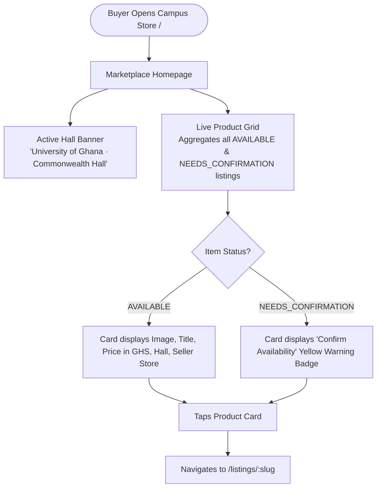

---

### 3.2 Search & Category/Hall Filtering

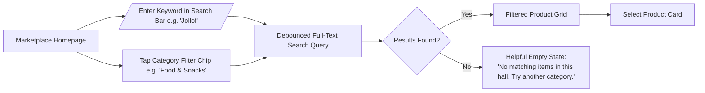

---

### 3.3 Product Detail & WhatsApp Contact

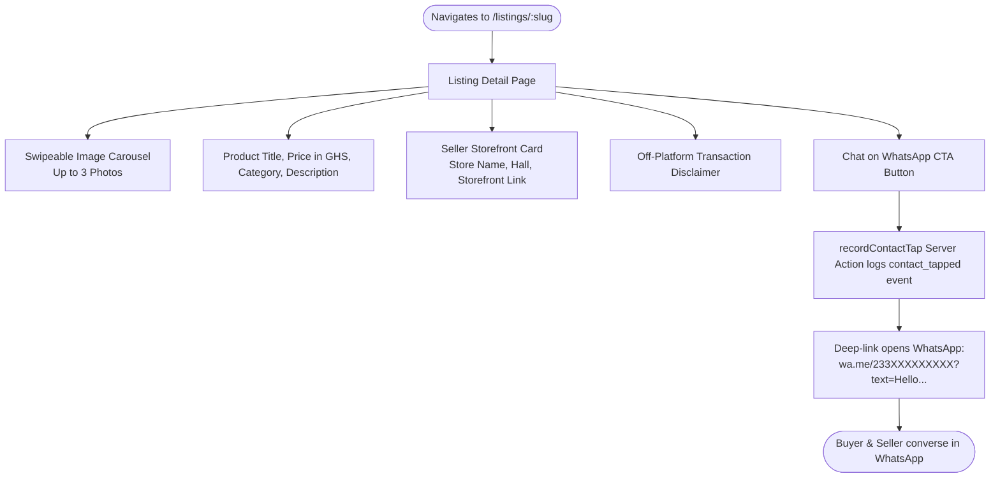

---

### 3.4 Seller Digital Storefront Discovery

Buyers can view a specific seller's entire product line under their unique URL:

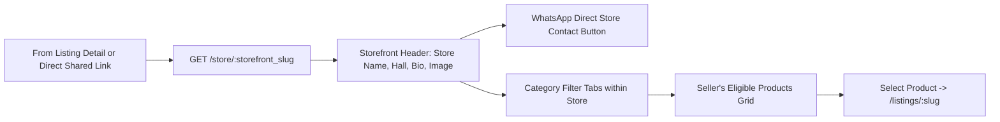

---

### 3.5 Anonymous Content Reporting

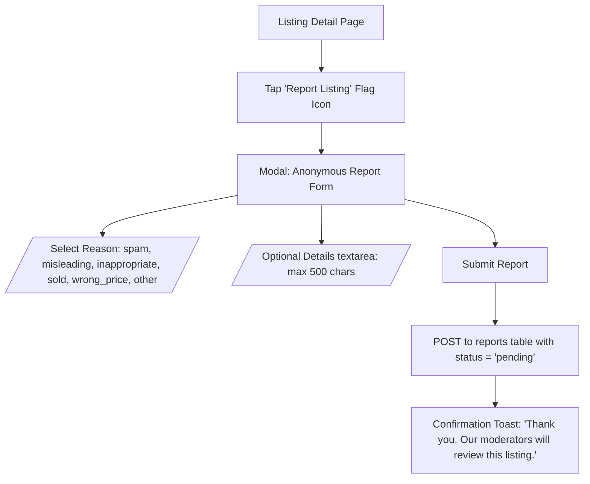

---

## 4. Seller User Flows

### 4.1 Registration & Email Verification

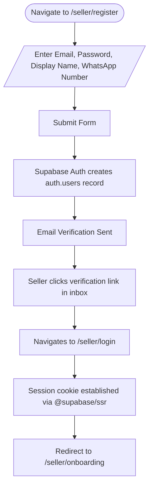

---

### 4.2 Storefront Onboarding (Pending Approval Gate)

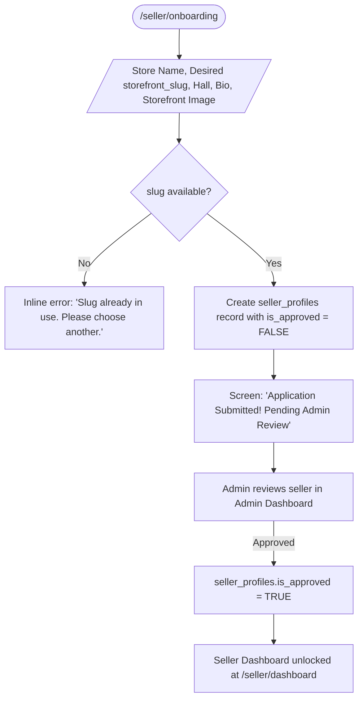

---

### 4.3 Publishing Products Across Diverse Categories

A single seller account publishes multiple listings in different categories:

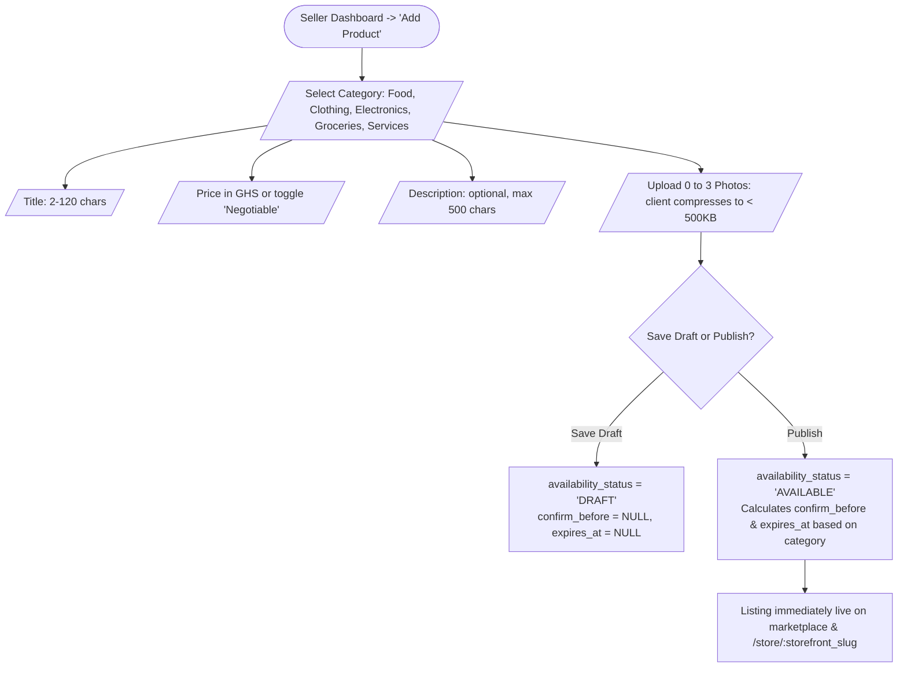

---

### 4.4 Editing & Managing Listings

```mermaid
flowchart LR
    A[Dashboard Listing Card] --> B{Select Action}
    B -->|Edit| C[Edit Form: update title, price, photos -> Save]
    B -->|Pause| D[availability_status = 'PAUSED' -> Hidden from public]
    B -->|Resume| E[availability_status = 'AVAILABLE' -> Timestamps reset fresh]
    B -->|Mark Sold Out| F[availability_status = 'SOLD_OUT' -> Hidden from marketplace]
    B -->|Delete| G[Sets deleted_at = now(), availability_status = 'REMOVED']
```

---

### 4.5 Two-Phase Availability Confirmation & Reactivation

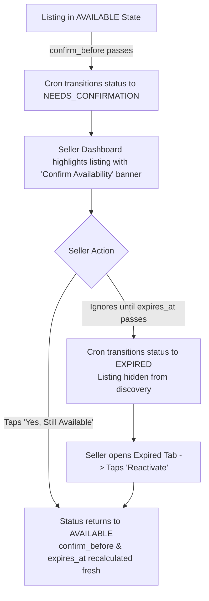

---

## 5. Administrator User Flows

### 5.1 Seller Application Review

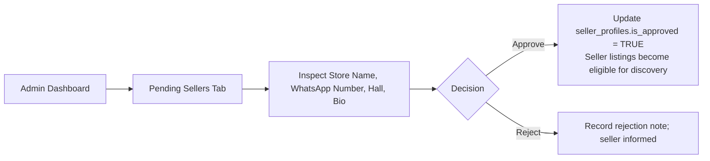

---

### 5.2 Listing Moderation & Takedowns

```mermaid
flowchart LR
    A[Admin Listings View] --> B[Inspect Any Listing across all statuses]
    B --> C[Takedown / Deactivate Action]
    C --> D[Sets availability_status = 'REMOVED', deleted_at = now()]
    D --> E[Appends 'removed' entry in listing_events with reason]
```

---

### 5.3 Buyer Report Resolution

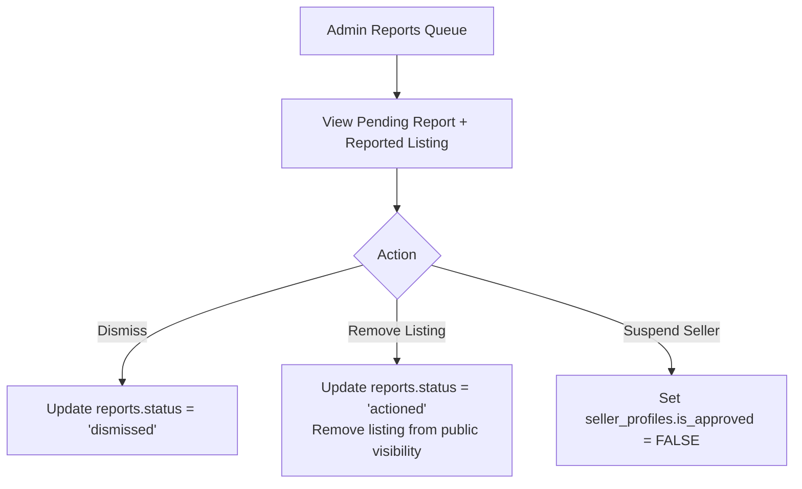

---

### 5.4 Manual WhatsApp Seller Reminders

When listings linger in `NEEDS_CONFIRMATION`, an admin can initiate a prefilled WhatsApp check-in:

```
https://wa.me/233XXXXXXXXX?text=Hi%20[Seller],%20is%20your%20listing%20'[Title]'%20still%20available%20on%20Campus%20Store?
```

---

## 6. Canonical State Transition Matrix & Edge Cases

| Scenario | Prior State | Action / Trigger | Resulting State | Timestamp Impact |
|---|---|---|---|---|
| **Seller confirms in time** | `NEEDS_CONFIRMATION` | Seller taps "Still Available" | `AVAILABLE` | Both `confirm_before` and `expires_at` recalculated fresh from `now()`. |
| **Confirmation window expires** | `NEEDS_CONFIRMATION` | Scheduled cron worker | `EXPIRED` | Hidden from public discovery. Timestamps unchanged. |
| **Seller pauses live item** | `AVAILABLE` | Seller toggles "Pause" | `PAUSED` | Hidden from public. Timestamps cleared. |
| **Seller resumes paused item** | `PAUSED` | Seller toggles "Resume" | `AVAILABLE` | Timestamps calculated fresh from `now()`. |
| **Seller marks sold out** | `AVAILABLE` or `NEEDS_CONFIRMATION` | Seller marks "Sold Out" | `SOLD_OUT` | Timestamps cleared. Excluded from general discovery. |
| **Seller restocks sold item** | `SOLD_OUT` | Seller marks "Back in Stock" | `AVAILABLE` | Timestamps calculated fresh from `now()`. |
| **Seller edits price/text** | `AVAILABLE` | Seller edits title or price | `AVAILABLE` | Timestamps are NOT prolonged (prevents expiry avoidance). |
| **Seller edits in confirmation** | `NEEDS_CONFIRMATION` | Seller edits details without confirming | `NEEDS_CONFIRMATION` | State remains until explicitly reconfirmed. |
| **Cron runs late / delay** | `AVAILABLE` or `NEEDS_CONFIRMATION` | Database query execution | Evaluated live | Public query filter `expires_at > now()` prevents expired items from displaying even before cron runs. |

---

## 7. Empty, Error & Boundary States

1. **No Active Listings in Hall:**
   - Display: *"Nothing on sale in this hall right now. Are you selling something? Tap Become a Seller to list in 3 minutes!"*
2. **Search With Zero Matches:**
   - Display: *"No products match '[query]'. Try a different search term or check all categories."*
3. **Storefront Has No Current Items:**
   - Display: *"[Store Name] currently has no active items. Check back later or message them directly on WhatsApp."*
4. **Seller Awaiting Approval:**
   - Display: *"Your storefront is under review by campus administrators. You can create drafts now; they will go live once your account is approved."*
5. **Listing Link Expired / Removed:**
   - Display: *"This listing is no longer available on Campus Store. Browse active listings in your hall."* With button to `/`.

---

*User flows specification verified and complete.*
